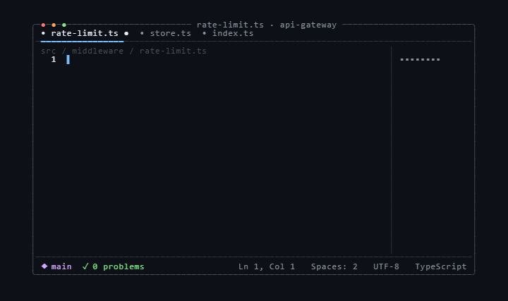

<div align="center">

# Hi there!  I'm Chintha Sampath Kumar

### 🚀 Full-Stack Developer | AI Enthusiast | Problem Solver
### 🎓 B.Tech CSE @ VNRVJIET | CGPA 9.33 | Turning Ideas Into Reality, One Line at a Time


[](https://git.io/typing-svg)

<p align="center">
  
  
  
  
</p>

</div>

---
---

## 🚀 About Me

<picture>
  <source media="(prefers-color-scheme: light)" srcset="assets/code-editor-light.gif">
  
</picture>

```typescript
const sampath = {
    pronouns: "He" | "Him",
    code: ["C", "C++", "Java", "Python", "JavaScript", "SQL"],
    askMeAbout: ["hackathons", "React", "JavaScript", "Python", "C++", "MERN stack", "RAG"],
    education: "B.Tech CSE @ VNRVJIET (2023 - Present) | CGPA 9.33",
    technologies: {
        frontEnd: {
            web: ["React", "HTML5", "CSS3", "JavaScript"],
            css: ["Tailwind CSS"]
        },
        backEnd: {
            js: ["Node.js", "Express"],
            python: ["FastAPI"],
            databases: ["MongoDB", "PostgreSQL", "MySQL", "Supabase", "Firebase"]
        },
        ai: ["RAG", "LLMs", "Agentic AI", "Vector Embeddings", "FAISS", "Gemini", "Groq"],
        analytics: ["Tableau", "Power BI"],
        tools: ["Git", "GitHub", "Postman", "Docker", "Figma", "Canva"]
    },
    currentlyLearning: ["DSA", "OOP", "LLD", "HLD", "Cloud Technologies"],
    currentFocus: "Building Full-Stack Applications with AI Integration",
    funFact: "I love photography, drawing, and solving logical puzzles 📸🎨"
};
```

### 🎯 Current Goals
- 🔭 Working on **Full-Stack & AI-Powered Projects**
- 🌱 Learning **DSA, OOP, LLD, HLD & Cloud Technologies**
- 👯 Open to collaborate on **Full-Stack, AI/ML & Open-Source Projects**
- 🤝 Looking for help with **System Design, Backend Development & DevOps**
- 💬 Ask me about **Hackathons, React, JavaScript, Python, C++ & the MERN Stack**
- ⚡ Fun fact: **I love exploring new technologies and turning ideas into reality!** 😄

---
---

## 💼 Experience

### ⚖️ Software Developer Intern — CounselGrid (CourtSync)

Legal technology platform · 3 months

Contributions

- 💬 Contributed to client–lawyer communication features
- 🗂️ Worked on case management features
- ✨ Improved overall platform usability

### ⚡ Software Developer Intern — Flyett

Workflow automation SaaS platform · 4 months

Contributions

- 🏢 Worked on a multi-tenant SaaS platform using Firebase and React
- ☁️ Developed Cloud Functions for workflow execution and role-based access
- 🖥️ Built key UI features integrated with Firestore and Firebase Auth

---

## 🏆 Achievements

- 🥇 **1st Place** — Webathon 4.0, organized by ACM VNRVJIET
- 🇮🇳 **Grand Finale (Chennai, Nov 2025)** — Smart India Hackathon (SIH) 2025
- 🌍 Participated in **Hack4SDG** conducted by IIT Hyderabad (Oct 2024)
- 💻 Recognized among the **top 100 coders** of VNRVJIET

---

## 👨‍💼 Leadership & Activities

- 🧑‍💻 Active member at **CSI SBC, VNRVJIET**
- 📸 Active member at **Scintillate**, the photography club of VNRVJIET
- 🎨 Won art, essay and history quiz competitions at school level
- 🏊 Won multiple district-level skating and swimming championships

```
Ownership
Communication
Consistency
Collaboration
Execution
```

---

## 🌟 Featured Projects

<table>
<tr>

<td width="50%" valign="top">

### 📜 Sanskrit Restore

#### AI-Powered Manuscript Restoration Platform

Full-stack AI platform for digitizing and restoring damaged Sanskrit manuscripts, with a hybrid RAG pipeline that combines vector search and LLM-based reconstruction.

**⚡ Features**

- 🔍 Hybrid RAG: FAISS vector search + LLM reconstruction
- 🖼️ OCR & image enhancement workflows
- 🔎 Semantic search over manuscripts
- ✍️ AI-assisted text restoration
- ⚙️ Scalable APIs for manuscript retrieval

**🛠️ Stack**

`React` `Node.js` `FastAPI` `PostgreSQL` `FAISS` `Gemini` `RAG`

[🔗 View Project](https://github.com/Sampath3763/your-sanskrit-restore-repo)

</td>

<td width="50%" valign="top">

### ⛏️ MINERVA

#### AI-Powered Mining Safety Platform

AI-powered mining safety solution combining computer vision, IoT, and role-based monitoring to improve worker safety.

**⚡ Features**

- 🦺 Real-time PPE detection
- 🚨 Hazard monitoring
- 🪖 Smart IoT helmets
- 🆘 Emergency SOS system
- 🔥 Fire detection
- 👥 Multi-role dashboards

**🛠️ Stack**

`React Native` `FastAPI` `YOLOv8` `ESP32` `Firebase` `PyTorch`

🏆 **Smart India Hackathon Grand Finale Winner**

[🔗 View Project](https://github.com/rajachanda/SIH-Minerva)

</td>

</tr>

<tr>

<td width="50%" valign="top">

### 🎬 Webathon4

#### CinYstore · Film Distribution Intelligence

AI-powered film distribution and marketing intelligence platform with poster analysis, release-window intelligence, and audience buzz tracking.

**⚡ Features**

- 🎨 AI poster scoring
- 📊 Buzz analytics
- 🗓️ Release window heatmaps
- 📺 YouTube & social metrics
- 📈 Competition analysis
- 🎯 Campaign blueprints

**🛠️ Stack**

`React` `Node.js` `Supabase` `Python` `ML`

🥇 **1st Place · Webathon 4.0 (ACM VNRVJIET)**

[🔗 View Project](https://github.com/rajachanda/Webathon4)

</td>

<td width="50%" valign="top">

### 🎮 HAVIT

#### AI-Driven Gamified Habit Tracker

Full-stack gamified habit platform with real-time analytics, XP/leveling, squads and a social feed, plus personalized AI coaching.

**⚡ Features**

- 📈 Real-time habit analytics
- ⭐ XP & leveling system
- 👥 Squad features
- 💬 Social feed
- 🤖 Personalized AI coaching (Gemini 2.5 Flash)
- 🔐 Secure Node.js services with optimized Firestore data models

**🛠️ Stack**

`React` `Node.js` `Express` `Firebase Admin SDK` `Firestore` `Gemini`

[🔗 View Project](https://github.com/rajachanda/HAVIT)

</td>

</tr>

</table>

---

### 📊 Project Highlights

| | |
|---|---|
| 🤖 **AI/ML** | RAG, LLMs & Intelligent Applications |
| 🏆 **Hackathons** | SIH 2025 Grand Finale · Webathon 4.0 Winner |
| 🌐 **Full-Stack** | Web Applications |
| 📱 **Web + Mobile** | Cross-Platform Development |
| ☁️ **SaaS** | Multi-tenant Production Experience |

---

## 🛠️ Tech Arsenal & Skills

<div align="center">

 **What I Work With** 

</div>

### 🎨 **Frontend**
<p align="center">
  
</p>

### ⚙️ **Backend & Languages**
<p align="center">
  
</p>

### 🗄️ **Database & Storage**
<p align="center">
  
</p>

### 🤖 **AI & Machine Learning**
<p align="center">
  
  
  
  
  
</p>

### 📊 **Data & Analytics**
<p align="center">
  
  
  
  
</p>

### 🛠️ **Development Tools & Workflow**
<p align="center">
  
  
</p>

### 📜 **Certifications**

- 🤖 Generative AI Course — Google On Campus
- ☕ Java Certification — Infosys Springboard
- 📱 Android App Development — BITS Hyderabad
- 📊 Tableau Course in Data Analytics
- 🔐 CyberSuraksha — Microsoft

---

### 🧩 DSA & Competitive Programming

<p align="center">

<a href="https://leetcode.com/u/Sampath6639/" target="_blank">
  
</a>

</p>

I enjoy solving problems that improve:

- logical thinking
- optimization skills
- debugging ability
- system-level intuition

Patterns > memorization.

---

## 📈 GitHub Stats

<div align="center">

<br/>
<br/>


</div>

---

## 📅 Contribution Graphs

### 🐍 **Contribution Snake Animation**
<div align="center">


</div>

### 📊 **Contribution Activity Graph**
<div align="center">


</div>

---

## 🤝 Let's Build Something Amazing Together!

<div align="center">

### 🌐 **Connect With Me**

<a href="https://www.linkedin.com/in/sampath3763/" target="_blank">
  
</a>
<a href="mailto:chinthasampath3763@gmail.com" target="_blank">
  
</a>
<a href="https://github.com/Sampath3763" target="_blank">
  
</a>
<a href="https://x.com/Sampath3763" target="_blank">
  
</a>
<a href="https://instagram.com/chintha_sampath126" target="_blank">
  
</a>
<a href="https://leetcode.com/u/Sampath6639/" target="_blank">
  
</a>
<a href="https://www.codechef.com/users/sampath_3763" target="_blank">
  
</a>

</div>

### 💼 **Open for Opportunities**
<div align="center">

```yaml
Currently Looking For:
  - Software Development Internships 🎯
  - Full-Stack Development Projects 💻
  - AI/ML Collaboration Opportunities 🤖
  - Open Source Contributions 🌟

Available For:
  - Remote Work ✅
  - Part-time Projects ✅
  - Hackathons & Competitions ✅
```

</div>

### 🎯 **Call to Action**
<div align="center">

[](https://your-portfolio-link.com)
[](https://drive.google.com/your-resume-link)
[](mailto:chinthasampath3763@gmail.com)

**📧 Email:** [chinthasampath3763@gmail.com](mailto:chinthasampath3763@gmail.com)  
**💬 Let's chat about:** `Full-Stack Development` `AI Projects` `Hackathons` `Collaboration`

</div>

---

<div align="center">

### 🌟 **Final Words**


 <em><b>I love connecting with different people</b> so if you want to say <b>hi, I'll be happy to meet you!</b> 😊</em>

---


</div>